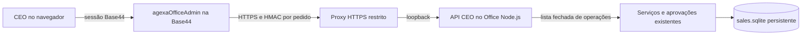

# API privada do CEO para o painel Base44

**Preparada e testada localmente; não publicada em hospedagem permanente ou Base44.**
As Fases anteriores e o escritório/editor original permanecem. Agentes, Nexus,
CRM, mensagens, IA, aprovações, relatórios e SQLite executam exclusivamente no
Node.js. A função Base44 autentica e encaminha; não contém motor de agentes.



## Autenticação e limites de confiança

1. O CEO entra pela autenticação gerida da Base44. A app deve ser privada.
2. Em **cada** chamada, `agexaOfficeAdmin` executa `auth.me()` e verifica o ID
   imutável numa allowlist backend. Não confia em role/email/actor enviados pelo
   navegador nem num campo de perfil editável. IDs de leitura e controlo separados.
3. A função assina a identidade verificada e a operação com chave exclusiva da
   ponte, mantida nos dois backends. Não usa nem recebe o token permanente do Office.
4. O Office repete a verificação da allowlist/permissão e exige validade de 90 s,
   nonce de uso único, HTTPS terminado no proxy confiável e Host exato.
5. A sessão de utilizador fica na Base44; o Office não emite token administrativo
   para o browser. Não foi implementado outro login/password nem outro CRM.

A duração, revogação, MFA e atributos reais de cookies/sessão da Base44 devem ser
verificados/configurados na conta real. O código usa o SDK oficial e não certifica
que a plataforma usa um cookie HttpOnly específico. Sessões expiradas ou utilizador
comum são recusados antes de chamar o Office. Retirar um ID da allowlist e aplicar
configuração/reinício revoga esse acesso na ponte; o pedido já em curso mantém a
janela curta assinada. Não há cache de autorização entre chamadas no BFF.

O fluxo novo não entrega ao browser chave HMAC, token permanente do Office, SQLite,
ficheiros de sessão, QR, terminal, SQL ou configuração de segredos. A UI original
privada mantém a autenticação legada; não a publicar através desta origem externa.
O proxy externo só publica a rota da ponte. O token legado é usado internamente
pelo servidor para reutilizar os handlers atuais, sem sair do processo.

## Endpoint externo e envelope

**POST `/api/ceo/v1/request`**, exclusivamente servidor Base44 → Office.
Não existe URL de produção nesta entrega. Origem do Office é configurada pelo
operador depois de provisionar hospedagem e HTTPS. Navegadores com `Origin` são
recusados nesta rota e não recebem CORS. A função Base44 aceita a origem exata
`https://agexa-flix.base44.app`; não usa wildcard de origem.

O browser chama `base44.functions.invoke('agexaOfficeAdmin', pedido)`.
Contrato browser (exemplo de leitura, sem actor/key/URL):

```json
{
  "operation": "tasks.list",
  "requestId": "f0671038-c0f4-4bf1-a2fb-f54e1cbd0977",
  "input": {"query": {"status": "blocked", "page": 1}}
}
```

`requestId`: UUID v4. `input` só admite `params`, `query` e `body`.
`params` só admite `id` opaco `[A-Za-z0-9_-]`, até 100 caracteres.
GET não admite body; POST não admite query. Nunca enviar path/URL/método arbitrário.
Controlo exige `confirm:true` após ação humana explícita. Não substitui autorizações
comerciais ou aprovações próprias do motor.

A função acrescenta `actorId` obtido de `auth.me()` e assina o JSON exato, com:

- `Content-Type: application/json`.
- `X-Agexa-Timestamp`: milissegundos UTC, 13 dígitos, janela de 90 segundos.
- `X-Agexa-Nonce`: novo UUID por tentativa de transporte.
- `X-Agexa-Signature`: HMAC-SHA256 hexadecimal da mensagem abaixo.

```text
AGEXA-CEO-V1
request
POST
/api/ceo/v1/request
TIMESTAMP
NONCE
CORPO_JSON_EXATO
```

Sem newline extra depois do corpo. A resposta usa a mesma construção com
`response` na segunda linha, timestamp próprio e o nonce recebido. A função
verifica assinatura, nonce, requestId, status e tamanho antes de devolver dados.
Não encaminha headers de autenticação do Office ao navegador. TLS permanece ativo;
não há redirects, URL escolhida pelo utilizador ou retries automáticos de comandos.

Exemplo de resposta real de formato, com lista vazia de fixture isolado:

```json
{
  "requestId": "f0671038-c0f4-4bf1-a2fb-f54e1cbd0977",
  "ok": true,
  "status": 200,
  "result": {"items": [], "total": 0, "page": 1, "pageSize": 25}
}
```

Todas as respostas privadas são `no-store`. Falhas antes da autenticação podem
ser `{error:string}` sem assinatura. O BFF devolve 502 se não conseguir verificar
uma resposta; nunca transforma falha em agentes/dados fictícios.

Contrato máquina gerado: `integrations/base44/office-admin.openapi.json` (OpenAPI
3.1, sem servidor de produção). Tipos/catálogo: `core/src/ceoBridge.ts`.
`npm run base44:bundle` gera função e contrato; `npm run base44:check` deteta drift.
A geração local não valida runtime Deno nem publica na Base44.

## Operações de leitura

Todas exigem ID autorizado de leitura ou controlo. Os caminhos abaixo são internos,
executados pelo servidor; não são rotas externas para o browser.

| operation | Serviço/rota existente ou extensão de leitura | input | result |
| --- | --- | --- | --- |
| `office.state` | Projeção do snapshot real | `{}` | version, suspended, employees, tasks resumidas, events, inference, objective |
| `tasks.list` | GET `/api/agexa/tasks` | query: status?, employeeId?, page? | items, total, page, pageSize=25 |
| `tasks.get` | GET `/api/agexa/tasks/:id` | params.id | SalesTask completo |
| `nexus.workflows` | GET `/api/agexa/nexus` | `{}` | workflows e orders persistidos |
| `crm.overview` | GET `/api/agexa/crm` | `{}` | CrmSnapshot original |
| `crm.companies` | GET `/api/agexa/crm/companies` | query: search?, sector?, city?, stage?, page? | Paginação CRM original |
| `crm.company` | GET `/api/agexa/crm/companies/:id` | params.id | CompanyDetail original |
| `conversion.overview` | GET `/api/agexa/conversion` | `{}` | ConversionSnapshot original, incluindo origem e métricas |
| `conversion.events` | GET `/api/agexa/conversion/events` | query: status?, page? | items, total, page |
| `reports.orion` | GET `/api/agexa/reports/orion` | query: page? | Tarefas Orion concluídas de tipo sales_report/crm_report/conversion_report, incluindo result |
| `integrations.state` | Projeção do snapshot real | `{}` | ia, base44, whatsapp |
| `messages.list` | GET `/api/agexa/messaging/conversations` | query: search?, state?, page? | Lista original de conversas autorizadas |
| `messages.detail` | GET `/api/agexa/messaging/conversations/:id` | params.id | Detalhe original de mensagens/rascunhos/handoff |
| `audit.list` | Metadados da ponte no mesmo SQLite | `{}` | Últimos 100 pedidos/negações auditados |

`employees` são `SalesEmployee` do contrato `core/src/agexa.ts`: id, name, role,
area, palette, hue, characterId, seatId, enabled, status, currentTask, completed,
errors e queued. Não existem funcionários ou atividade definidos pelo frontend.

`office.state.tasks` resume as últimas 200 tarefas: campos SalesTask, retirando
input/result e acrescentando `resultAvailable`. `events` contém os últimos 100.
Para histórico completo/execução/bloqueios usar `tasks.list` (25/página), estados
`queued`, `running`, `awaiting_approval`, `blocked`, `completed`, `error`, `cancelled`.
`tasks.get` contém input/result autorizados para revisão. Listas não se fazem passar
por stream histórico completo. Paginação ordena por criação/rowid, não é snapshot
imutável; atualizar a página pode refletir novas tarefas.

`integrations.state` devolve:

```ts
{
  ia: { connected, provider, message, model, credentialConfigured },
  base44: { appId, endpointConfigured, status, secretConfigured, lastSync, error },
  whatsapp: { provider, status, simulated, qrAvailable }
}
```

Indicadores não provam inferência, entrega ou pagamento. Preservar rótulos de
simulação/origem. A ponte não ativa oferta, integração, modelo, envio ou WhatsApp.
Os restantes formatos são os contratos originais em `core/src/{crm,conversion,
messaging,intelligence}.ts`, sem um esquema comercial paralelo.

## Operações de controlo

Exigem ID autorizado de **controlo** nos dois backends e `confirm:true` no envelope.
Campos body são os dos endpoints existentes, validados por eles.

| operation | input | Efeito real |
| --- | --- | --- |
| `nexus.command` | body: {goal, input} | Solicita plano Nexus; distribuição continua a exigir aprovação |
| `nexus.order` | body: {goal, sourceId, sector, city, useAI} | Ordem comercial com fonte e aprovações existentes |
| `task.approve` / `task.cancel` | params.id | Aprova/cancela pela máquina de estados existente |
| `workflow.approve` / `workflow.cancel` | params.id | Aprova/cancela plano Nexus elegível |
| `order.approve` / `order.cancel` | params.id | Aprova/cancela ordem comercial elegível |
| `employee.set` | params.id, body: {enabled:boolean} | Inicia/pausa o funcionário pelo motor existente |
| `operations.set` | body: {suspended:boolean} | Suspende/retoma operações pela regra existente |
| `operations.stop` | `{}` | Suspende motor e mensagens com o stop existente |
| `crm.draft.review` | params.id, body: {status:"approved" ou "rejected"} | Revisão CRM existente |
| `message.review` | params.id, body: {decision:"approved" ou "rejected"} | Revisão de rascunho de mensagem pelas regras existentes |

Não existe operação de terminal, SQL, secret/configuração de fornecedor, pagamento
manual ou envio externo direto nesta lista. Aprovar não elimina consentimento,
piloto, suspensão ou bloqueio de conversa do CEO. Os handlers originais continuam a
decidir o que está permitido. Não ativar canais ou automatismos para testar o painel.

Nexus exige `body.input.authorized:true` para dados autorizados pelo CEO; a ponte
não introduz essa declaração automaticamente. Preservar restrições de dados,
orçamentos e JSON. Sem IA real ligada, mostrar bloqueio/erro verdadeiro do motor.

## Idempotência, auditoria e consulta periódica

Para cada ação humana gerar e conservar um requestId. Repetição após resposta
perdida usa **o mesmo ID e conteúdo**, com nonce de transporte novo gerado no BFF.
Chaves de objetos são normalizadas para comparar conteúdo. Pedido alterado com o
mesmo ID dá 409. A resposta pode ser recuperada até 24 horas. Depois mantém-se o
registo de execução e exige revisão; não repete automaticamente a ação.

Reserva persistente precede execução. Se o processo cair entre efeito e resposta,
o estado fica incerto: 409 e revisão da tarefa/auditoria. Não existe promessa de
transação distribuída ou execução exatamente uma vez. Nunca contornar um 409/502
criando outro ID e repetindo sem verificar se a primeira ação aconteceu.

Metadados vivem em `ceo_nonces`, `ceo_limits`, `ceo_commands` e `ceo_audit`, no
**mesmo sales.sqlite**. As tabelas só são preparadas quando a ponte está configurada.
Não mudam o modelo comercial ou criam outro banco. Nonces têm TTL; limite autenticado
60 pedidos/minuto por actor persistido. Limite pré-autenticação global 300/minuto por
processo. Cache de resultados de controlo é privado e limpo após 24 h ao processar
novos comandos; tombstones e auditoria persistem. Não guardar estes resultados no
browser/localStorage. A auditoria guarda identidade, operação, ID, hora e status;
não guarda chave, assinatura ou corpo do pedido. Negativas pré-auth usam identidade
`untrusted`. Definir política de backup/retenção desta metadata no host persistente.

O cliente fornecido consulta `office.state` a cada 5 segundos, sem pedidos sobrepostos,
salta páginas ocultas e recua para 30 s em erro. Dispose ao desmontar/sair.
São consultas periódicas, não um WebSocket nem execução simulada. Não abrir o WebSocket
legado com token no browser Base44. Um watcher por painel; carregar outras listas por
pedido e respeitar quotas reais do plano Base44. O modo de atualização manual é válido.

Erros habituais: 400 contrato/confirmação, 401 autenticação, 403 origem/identidade/
permissão, 404 tarefa inexistente, 409 repetição/conflito/estado incerto, 413 tamanho,
429 quota, 503 configuração, 502 BFF sem resposta verificável. Não devolver stack,
conteúdo de ficheiros ou credenciais ao frontend. Usar requestId para diagnóstico.

Ver [frontend Base44](AGEXA_BASE44_CEO_FRONTEND.md) e
[hospedagem/HTTPS](AGEXA_CEO_DEPLOY.md).
