# Capturas do AGEXA AI OFFICE

Estas capturas foram produzidas durante os testes em dados isolados.
A captura da Fase 3 utiliza uma API Ollama simulada e não comprova inferência com um modelo real.

## Fase 6 — conversões e Free Trial Tracker

Backend/SQLite reais em diretório temporário, **dados comerciais fictícios**.
Três contas/testes e um recibo são explicitamente simulados; o funil real permanece
zero. O convite usa MockWhatsAppProvider, sem conta real, e o cenário não executa
inferência. Não houve autenticação Base44. As capturas não representam vendas reais.

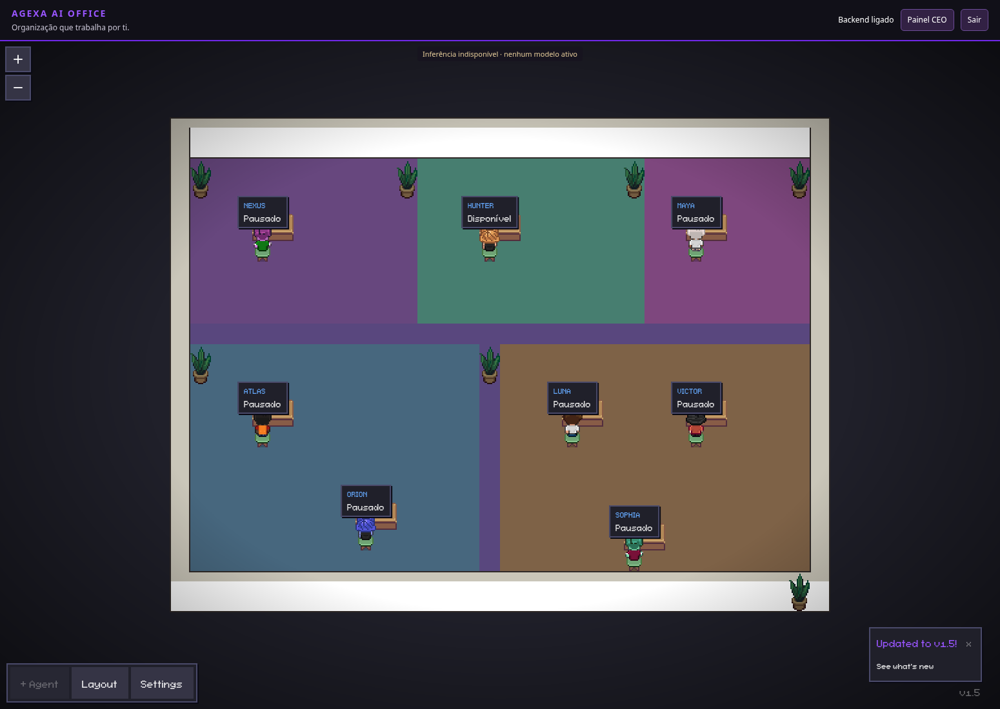

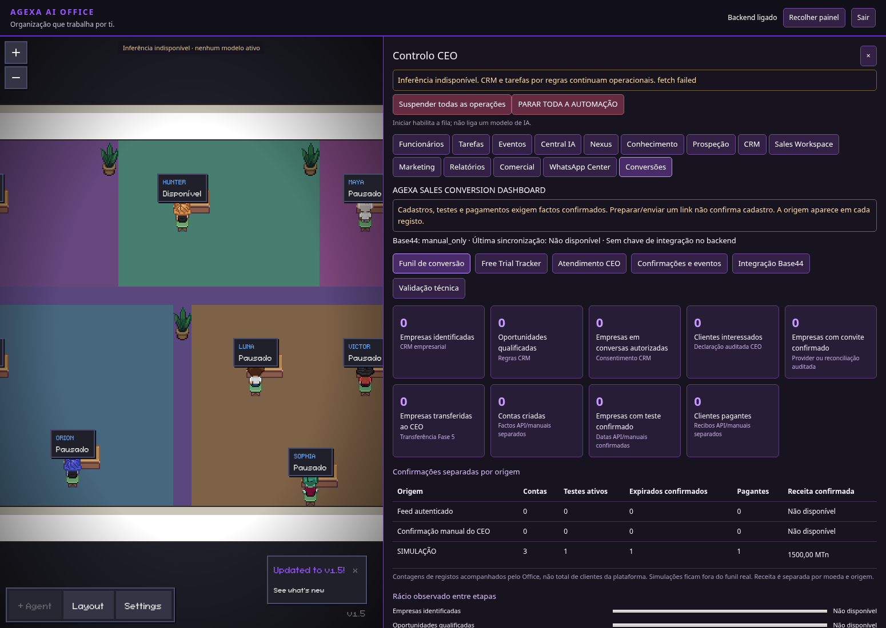

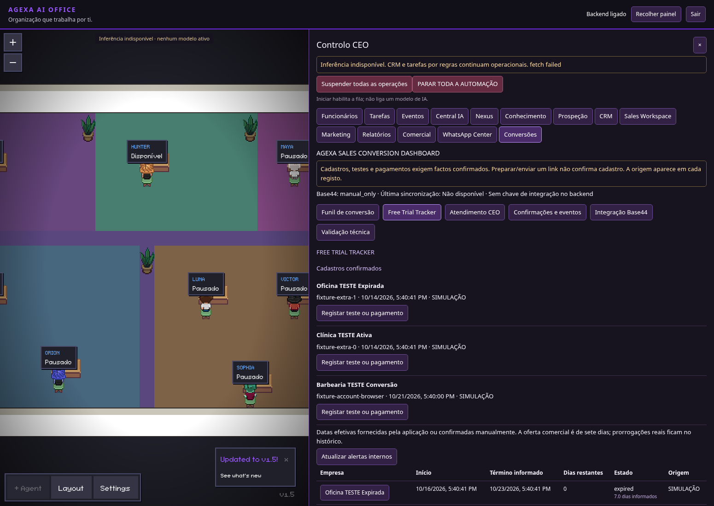

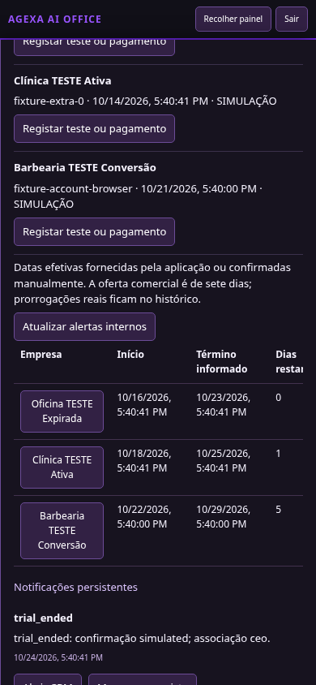

## Fase 5 — inbox e atendimento aprovado

Mensagens e número **fictícios**, provider Mock, backend/SQLite reais em diretório
isolado. Rascunhos gerados por regras, sem inferência. Os envios confirmados nesta
captura são exclusivamente simulados. Não foi autenticada uma conta WhatsApp real.
Nenhum QR, sessão ou conversa real foi publicado.

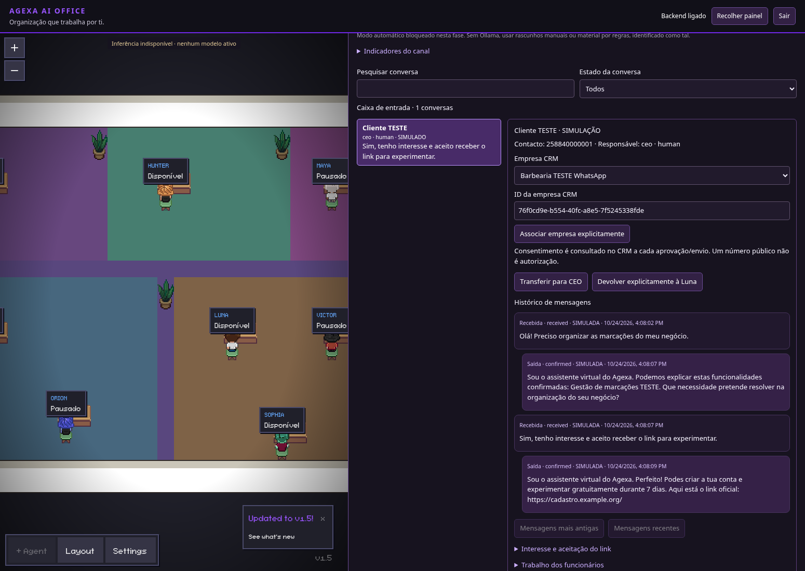

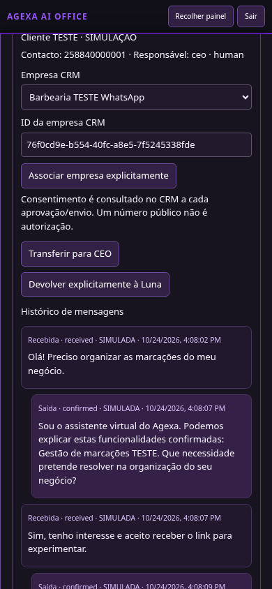

## Fase 4 — CRM e escritório

Estas capturas usam apenas duas empresas fictícias, identificadas como `simulated`.
A aplicação executou importação, qualificação, consentimento de teste, rascunhos e
coordenação por regras. **Sem inferência IA nem mensagens enviadas.** Os relatórios
não contam estas empresas como oportunidades reais. A ausência de Ollama é indicada
no escritório e no painel.

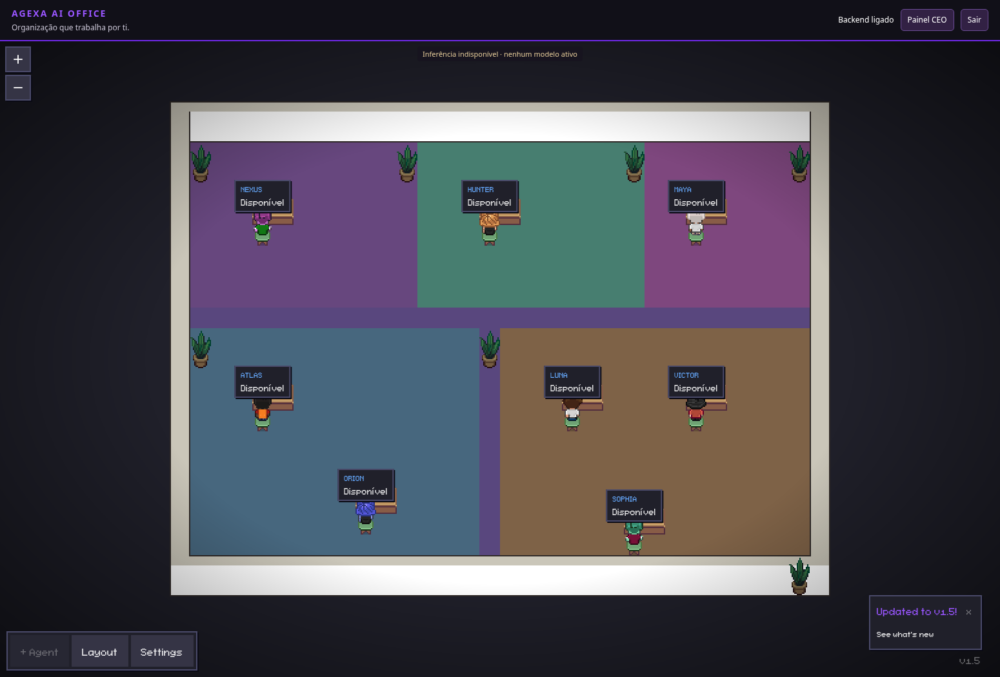

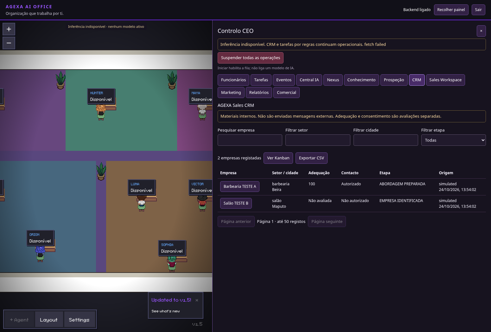

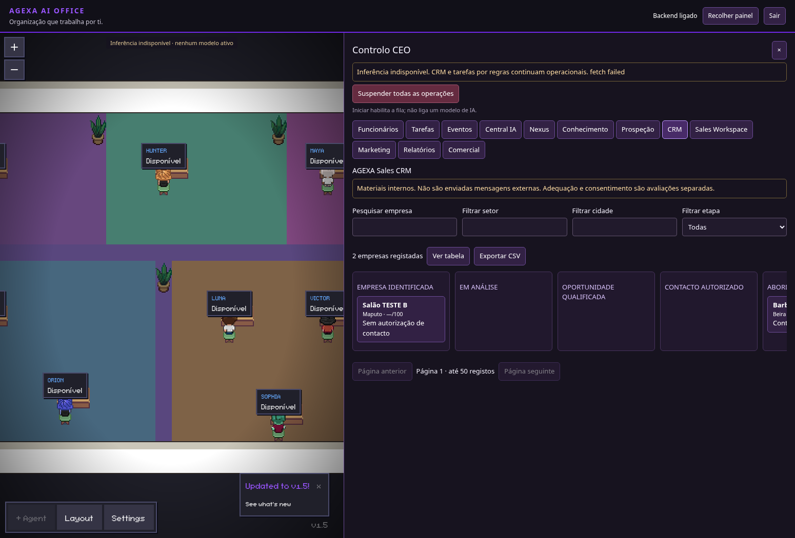

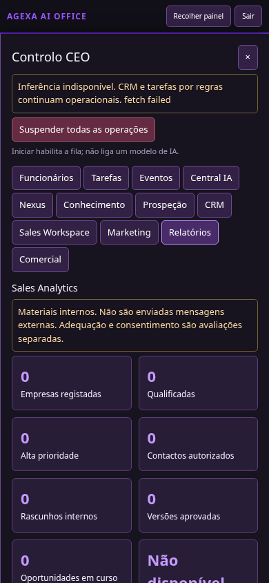

## Fase 3 — teste simulado de colaboração

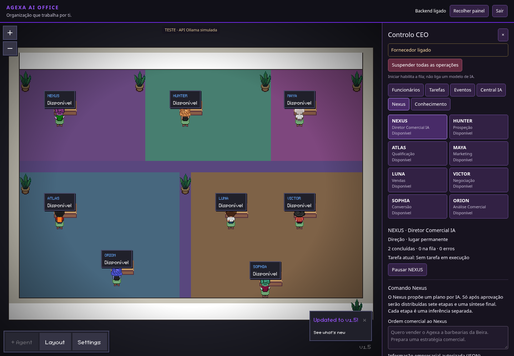

## Fase 2 — desktop

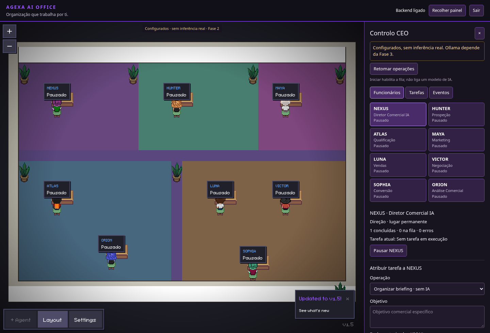

## Fase 2 — telemóvel

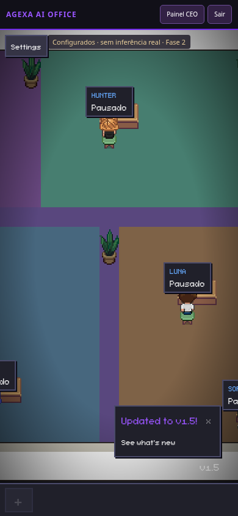
